We study MegaGem, a three-player, general-sum, imperfect-information auction game developed by Jane Street, and train a 4B specialist to play it.

SFT raises Qwen3-4B-Instruct's benchmark rating from 551 to 1158, ahead of Claude Sonnet 4.6, Claude Opus 4.8, and GPT-5.5. Distilling an analytic expert raises it further to 1275, the highest rating in the benchmark and roughly equal with Gemini 3.1 Pro.

Our rollout infrastructure handles multi-agent evaluation, self-play, and data generation. We measure no improvement from relative-outcome self-play against the frozen SFT model. The runs do generate enough bid data to fit a market model and distill a stronger bidder.

The released weights are available on Hugging Face: the [SFT checkpoint](https://huggingface.co/djdumpling/qwen3-4b-instruct-megagem-sft-step1200-v2) and the final [distilled checkpoint](https://huggingface.co/djdumpling/qwen3-4b-instruct-megagem-distill-para). The repository can be found [here](https://github.com/djdumpling/MegagemBench).

This blog would not be possible without the ongoing support of many people. I'm especially grateful to [Johannes Hagemann](https://x.com/johannes_hage?lang=en), [Sebastian Müller](https://x.com/omouamoua), [Christian Reetz](https://x.com/creet_z), and [Peyton Walters](https://x.com/peywalt) for their generous provisioning of credits for compute and access to model APIs. Additionally, thank you to early readers for providing invaluable feedback, including Sebastian Müller, Varun Srivastava, Nan Jiang, Austin Feng, Stephen Xia, Aaron Yu, and Lauren Shen.

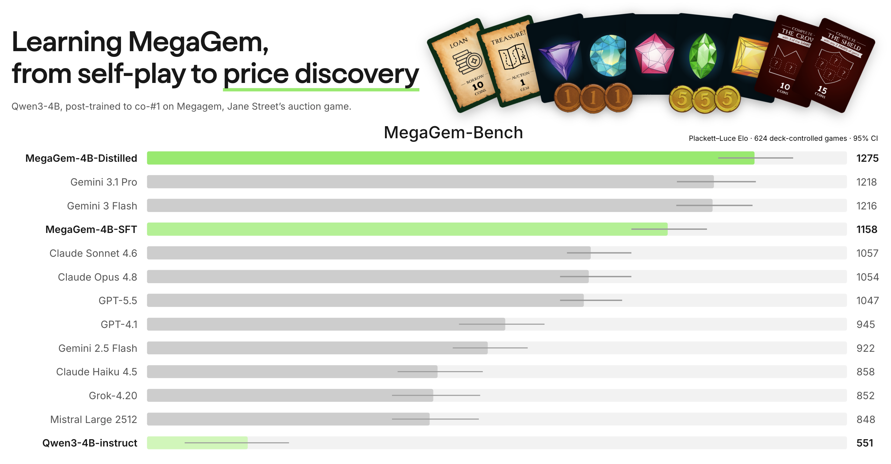

*Reading note:* To keep the main argument moving, several derivations, diagnostics, and examples are collapsed by default. Feel free to read linearly or ignore collapsed sections :).

## table of contents

- [understanding MegaGem](#understanding-megagem)
- [why MegaGem is hard for self-play](#why-megagem-is-hard-for-self-play)
- [environment](#environment)
- [evaluation design](#evaluation-design)
- [data and SFT](#data-and-sft)
- [self-play results](#self-play-results)
- [bid-distribution model](#bid-distribution-model)
- [live failure of the myopic selector](#live-failure-of-the-myopic-selector)
- [pricing liquidity](#pricing-liquidity)
- [refitting on SFT bids](#refitting-on-sft-bids)
- [distillation](#distillation)
- [final benchmark](#final-benchmark)
- [specialist traces](#specialist-traces)
- [conclusions](#conclusions)

## understanding MegaGem

Three (can be up to 5) players each start with 35 coins and a private hand of five gems. Each round, an auction card is flipped and all players submit bids simultaneously. Highest bid wins, with ties broken by turn order. The winner takes the auction, then reveals one gem from their hand publicly. The public Value Chart maps that display to everyone’s gem values. The final score is

$$
\text{final score}=\text{coins left}+\text{collection value}+\text{mission rewards}-\text{loan repayments}+\text{investment returns}
$$

The game ends when no treasure gems remain to be auctioned, typically after ~15 rounds.

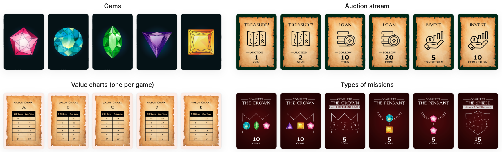

Full rules

* goal: obtain the highest final score.
* setup: each of the 3 players starts with 35 coins and a private hand of 5 gems. The auction deck is shuffled. 4 missions are revealed and a value chart is fixed for the game
* auction types:
  * treasure: bid to add the revealed gem(s) to your collection.
  * loan: take coins now, repay at the end during scoring. Loans are the only way to bid above your current coins.
  * investment: pay your bid now (coins locked) but at scoring, you get the bid back plus the bonus.
* missions: each requires a combination of gems won in auctions. A mission can be claimed only once, by the first player who completes it. The reward is paid out at final scoring.
* each round: flip the top auction card and have everyone submit a sealed bid simultaneously; the highest bid wins, with ties broken by turn order (the winner moves to the back of the line). The winner takes the auction payoff, then reveals one gem from their private hand to the public Value Display.
* value display: a public pool of gems that players reveal from their private hands. At the end, each player reveals their remaining private gems into the display. The terminal display is therefore fixed when the hands are dealt, although players reveal it gradually.
* gem values: each auctioned gem in a player’s collection is worth the amount dictated by the Value Chart, purely as a function of how many gems of that color appear in the Value Display. For example, with Chart A ($1 \to 4, 2 \to 8, 3 \to 12, \cdots, 5+ \to 20$) and 3 red gems in the display, 2 red gems in a player’s collection are worth $2 \cdot 12 = 24$ points.
* game end: the game ends when there are no more gems to auction, typically after ~15 rounds.
* final score: coins left in hand + collection gem value + mission rewards − loan repayments + investment returns.

At its core, MegaGem combines three familiar strategic games. In [Figgie](https://www.figgie.com/), each player observes only part of the supply and must infer fair value from what others are willing to pay and what is revealed over time. In [Splendor](https://en.wikipedia.org/wiki/Splendor_(game)), public objectives create races while players also need to think about improving their own position, preserving flexibility, and blocking opponents. In **poker**, hidden hands and previous actions incentivize opponent modeling while position and stack sizes determine which late-game outcomes can still be forced. MegaGem further adds repeated sealed-bid auctions.

### examples

To understand the game better, let's walk through six decisions from different points in a game.

<strong>Decision 1: a private hand changes expected value</strong>

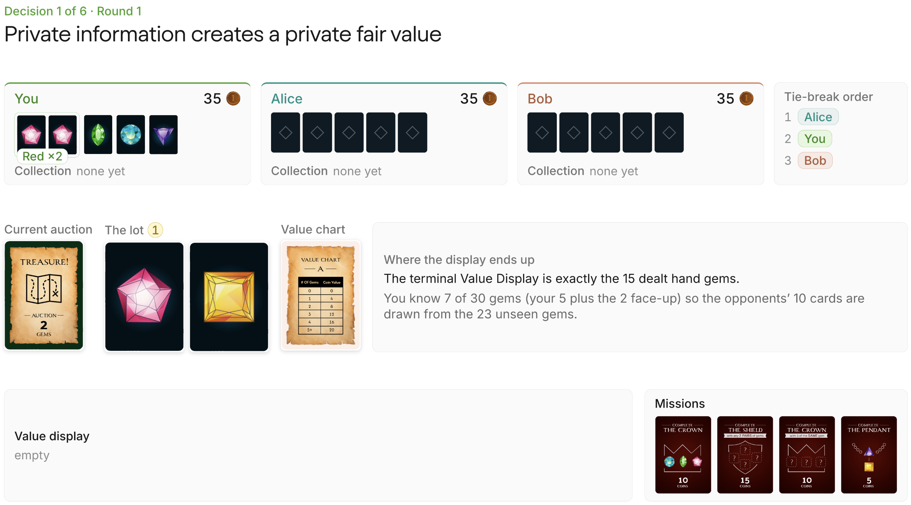

The 30-gem deck contains six gems of each color, and the terminal Value Display is the 15 gems dealt into players’ hands. Considering your 5 gems and the 2 revealed publicly, 23 gems remain unseen and the opponents’ 10 cards are drawn from them. Let $N_R$ and $N_Y$ be the display counts for Red and Yellow respectively at the end of the game, and $V$ the corresponding value dictated by the value chart A, which pays 4 points per displayed gem up to 5. Then,

$$
\begin{aligned}
\mathbb E[N_R] &= 2 + 10\left(\frac{3}{23}\right)=\frac{76}{23} \implies \mathbb E[V_R] = 4\mathbb E[N_R]=\frac{304}{23}\approx13.22\\
\mathbb E[N_Y] &= 10\left(\frac{5}{23}\right)=\frac{50}{23} \implies \mathbb E[V_Y] = 4\mathbb E[N_Y]=\frac{200}{23}\approx8.70\\
\mathbb E[V_{\mathrm{lot}}] &= \mathbb E[V_R]+\mathbb E[V_Y]
=\frac{504}{23}\approx21.91
\end{aligned}
$$

<strong>Decision 2: missions create discontinuous value</strong>

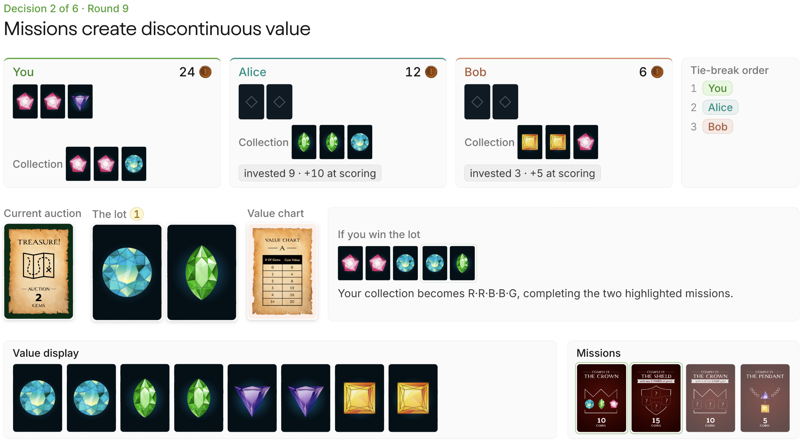

Winning the Blue–Green auction changes your collection to Red–Red–Blue–Blue–Green, completing two of the missions for 25 points total. Factoring in the blue and green gems from the lot and their values on the display, we know that winning this lot is worth at least $25+2\cdot4+2\cdot4=41$. Because neither Alice nor Bob has more than 12 coins and you are first in tiebreak order, you can win the auction for 12 and earn at least $41-12=29$ in positive EV. Their lack of liquidity lets you take the auction much more cheaply.

<strong>Decision 3: tiebreak positioning</strong>

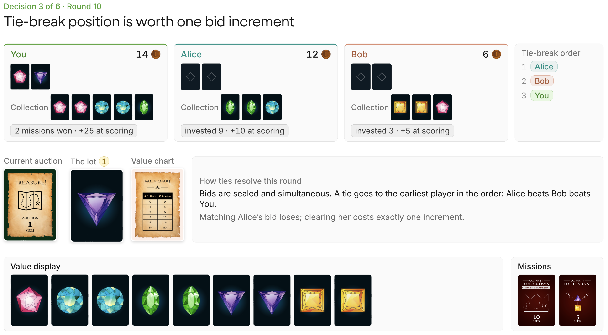

Because you are last in tiebreak order, matching Alice’s bid is a losing action: to clear a predicted bid of $b$, you must bid $b+1$. Alice can bid at most 12 and Bob at most 6, so 13 is the minimum bid to guarantee the lot. However, this increase must still be weighed against the gem’s value and the option value of keeping that coin for the remaining auctions because it may make the lot no longer worth bidding on.

<strong>Decision 4: reveals moving markets</strong>

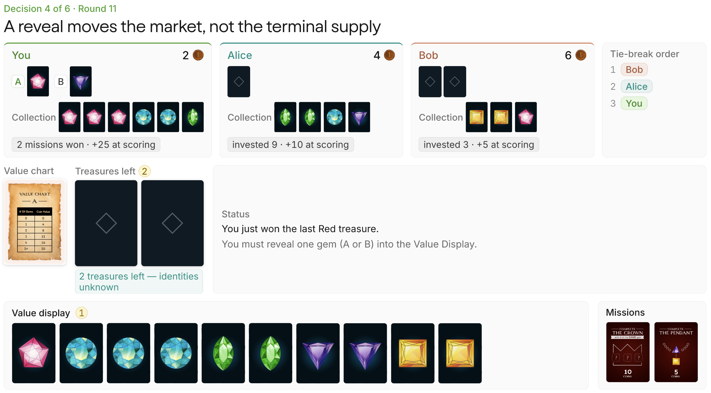

Both cards enter the value display regardless, so revealing Red or Purple does not change final gem values, but it changes what other players are willing to pay before then. Revealing Purple moves the current quote from 8 to 12. Bob already owns Yellow gems, so another Purple would also complete the 5-point Pendant mission. This reveal raises his visible reservation value for a future Purple from roughly 13 to 17 which can be useful if the goal is to induce Bob to spend his six coins, but it also makes the Purple harder to buy or deny, especially when you have only two coins and act last in ties.

Revealing Red has the opposite advantage. Moving Red’s quote from 4 to 8 has a null effect on public perception because there are no more red gems to be auctioned off (all 6 are either in a collection or will be in the value display). It also keeps Purple quoted at 8 while your hidden Purple guarantees that its terminal supply is higher than the table can see. This usually makes Purple easier to snipe later (for example, to block Bob's pendant). Revealing Red does advertise more of your lead (making you a bigger threat to other players who want to block you), but its direct price impact is confined to a market that has already closed.

<strong>Decision 5: loans and liquidity vs face value</strong>

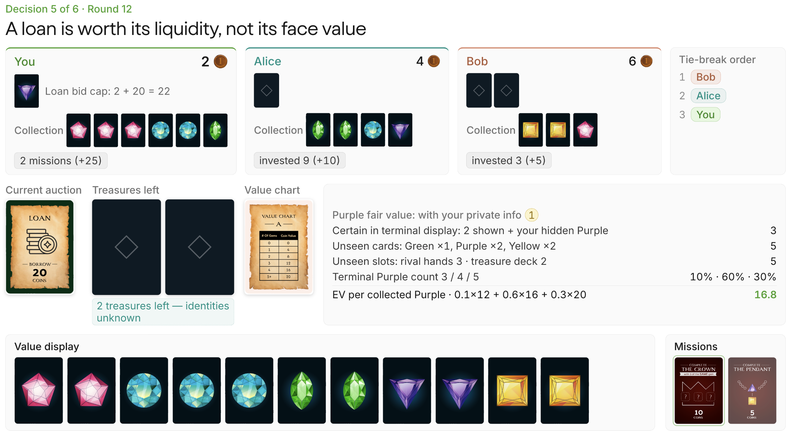

The 20 borrowed coins are matched by a 20-point repayment at scoring, so the principal itself creates no terminal value. Winning the loan for 10 changes your available cash to $C_{\mathrm{after}}=2+20-10=12$, but terminally you are 10 coins poorer. For example, if you win and have 14 coins, you can guarantee winning the last two auctions by first paying 7 (beating Bob in the tiebreak) and 7 again (winning moves you last in the tiebreak while Bob's liquidity remains 6).

Of the five cards still hidden, two are Purple, which puts a Purple gem's expected value at $0.1(12)+0.6(16)+0.3(20)=16.8$.

With 2 coins, under rational play by your opponents, you would never be able to win the last two auctions. But for the reasons explained above, the loan gives you an out to win these last two, and because the EV suggests a positive trade, it is worth winning the loan auction.

<strong>Decision 6: late-game bidding</strong>

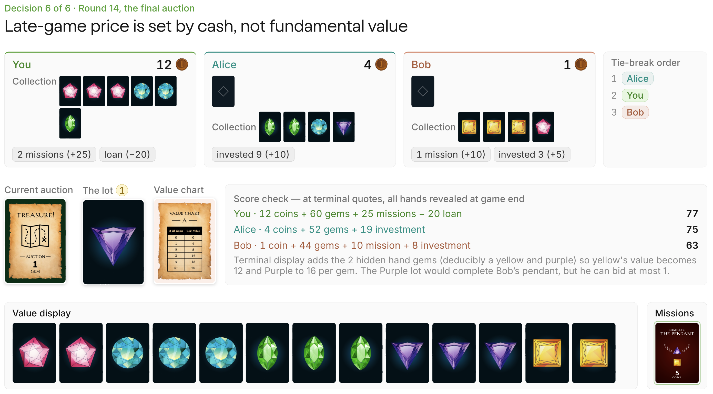

Before the final lot, terminal-value accounting puts you at 77, Alice at 75, and Bob at 63. The Purple gem is worth 16 on Chart A and it would also complete Bob’s 5-point Pendant mission, but Bob has only 1 coin. Playing it out, 5 is the smallest bid to cover both Bob and Alice, allowing 11 in free EV.

$$
\begin{aligned}
S_{\mathrm{Bob}}(1) &= 63+16+5-1=83\\
S_{\mathrm{Alice}}(4) &= 75+16-4=87\\
S_{\mathrm{You}}(5) &= 77+16-5=88
\end{aligned}
$$

## why MegaGem is hard for self-play

Several well-known RL systems use self-play: [AlphaGo](https://www.nature.com/articles/nature16961) in Go, [AlphaStar](https://www.nature.com/articles/s41586-019-1724-z) in StarCraft II, and [Pluribus](https://doi.org/10.1126/science.aay2400) in poker. The broad recipe trains a policy against copies or historical versions of itself (fictitious self-play) and rewards good play. The learner and its opponents' co-evolvation creates a curriculum without a fixed external teacher. Self-play also works outside two-player zero-sum (2p0s) games, but it is cleanest in that setting.

Training an LLM adds another source of noise. Temperature sampling spreads entropy across an autoregressive response, credit must flow through a natural-language trajectory, and many different responses can collapse to the same parsed bid.

<strong>2p0s games</strong>

Chess, Go, and heads-up poker are standard examples. Due to 0-sum, a value function can describe the expected outcome from a position for either player, with the sign reversed for the opponent. Think of the evaluation board on online chess.

You must assume the opponent chooses whatever hurts your position the most. The natural response is to choose  the strategy with the best worst case, the maximin. The opponent does the converse, minimizing the maximum value you can obtain, the minimax. [Von Neumann’s minimax theorem](https://en.wikipedia.org/wiki/Minimax_theorem) says these values are equal. If neither player can improve by deviating alone, the joint policy is in Nash equilibrium. In a 2p0s game, its equilibrium strategies are also minimax.

Ordinary policy-gradient self-play can still cycle (e.g. rock-paper-scissors), so practitioners often average policies or train with fictitious self-play, policies designed for exploitation, and more diverse policies. These mechanisms can stop the fresh policy from forgetting old weaknesses.

MegaGem breaks this clean setup in five ways:

- **payoffs don't sum to zero.** Interests can be partly aligned rather than strictly opposed, so multiple equilibria exist and self-play can settle into private conventions that fail against a new partner.
- **three players allow kingmaking.** A losing player can decide who wins. When that action barely changes its own reward, a policy-gradient update receives almost no signal for which rival benefits. "Improvement" therefore has to name an opponent distribution.
- **deals are stochastic.** Terminal score partly reflects the hand rather than the decisions, so we compare policies on the same deal.
- **the hidden state reveals itself.** Terminal gem values are fixed when hands are dealt but become public gradually, so a reveal can move perceived value without moving terminal value.
- **bids are simultaneous.** Choosing a bid requires a distribution over clearing prices, so a raw estimate of the auction is insufficient.

<strong>two-player general-sum games</strong>

General-sum games remove the requirement that the players’ payoffs add to a constant in every outcome.

1. In mixed-motive games, interests are neither perfectly opposed nor perfectly aligned.The prisoner’s dilemma is the classic example: both players prefer cooperating to mutual defection, but each is incentivized to deviate. Settlers of Catan has the same flavor through beneficial trades, temporary coalitions, and coordinated attempts to block players.
2. In fully cooperative games, every player receives the same payoff. Self-play can still learn arbitrary private conventions that fail when a new partner has learned a different convention. Hanabi is the standard example: two policies can each be effective with copies of themselves yet coordinate poorly with one another.

If you’re interested in the cooperative side of multi-agent RL, Arturo wrote a great [hands-on account of training LLM agents to play Hanabi](https://nphard.io/2026/02/23/hanabi.html), including the communication conventions that emerge under self-play.

<strong>three-player general-sum</strong>

The additional seats changes what "best play" means. Suppose Alice and Bob are close to first while Carol is too far behind to catch either. Carol may still decide the winner by bidding up one leader or letting the other buy cheaply, even when both choices leave her own score almost unchanged. A policy-gradient update based on Carol's reward has little basis for preferring one.

Even an ordinary bid depends on who is sitting across the table. One coin is enough to beat a player who always bids 0; it is useless against an opponent likely to bid higher. There is no opponent-independent optimal bid.

We can still ask whether a player would gain by deviating from a specified set of policies, but that is a local question. Here, “improvement" means improvement against a particular opponent distribution, equilibrium selection, or training population. A self-play reward describes that population rather than providing a universal ranking of policies.

<strong>chance, hidden state, and revelation</strong>

Deal luck is the most immediate evaluation problem. A strong hand can raise terminal score even when the player makes worse decisions, so we compare policies on the same deal to remove much of that noise.

During play, a seat sees its private hand and the public history, not the full deal. That view represents many hidden worlds that are still possible, with each bid or reveal changing their relative plausibility. A poker four-bet works the same way: the cards remain hidden, but stronger hands become more likely. MegaGem is therefore a partially observable Markov decision process (POMDP). A board snapshot alone is not enough to value a position; we also need the player's beliefs about what remains hidden.

Sealed bids add another unknown. To evaluate a candidate bid $b$, we need $P(\text{win}\mid b)$, the chance that it clears both opponents. Raising the bid improves that chance but leaves less surplus if it wins.

Reveals have an unusual role in this game. The initial deal fixes the terminal gem values because every private gem eventually enters the public Value Display. Choosing which gem to show does not alter that final display, but it does alter what the table believes before the remaining auctions. A reveal can move today's price without changing the gem's eventual value.

The auction result carries information too. If both opponents decline to pay your price for a lot with shared value, you may have overestimated it—the auction version of the winner's curse. That signal is weaker when private missions matter, since the same lot can reasonably be worth different amounts to different seats.

## environment

Using Prime Intellect's [verifiers](https://github.com/PrimeIntellect-ai/verifiers), we build the [RL environment](https://app.primeintellect.ai/dashboard/environments/djdumpling/megagem) around LLM clients playing one another. The implementation described here uses the legacy v0 API, but the newer, v1 API natively supports multi-agent RL environments such as this one!

To reduce context cost, a game runs as chained single-turn interactions. On every round, each player receives all information available to that seat, including the public state, their private hand, and the public history of the last five auctions (to maintain a sort of multi-turnness). The model returns a structured response and the environment parses the bid, resolves the winner, and prompts that player again if a gem reveal is required. Each game emits a trajectory containing the prompts, responses, parse and legality telemetry, bids, public state, final scores, and the seed needed to reconstruct the deal.

The environment emits complete game trajectories without defining the RL reward. A separate offline scorer reconstructs per-turn credit, and the update masks every opponent token so only the trainable seat receives gradients.

## evaluation design

The benchmark separates three views of performance:

- **Elo-scaled Plackett-Luce rating**: full-field latent strength determined from three-way rankings, used in the final leaderboard
- **first-place rate**: fraction of games a policy wins (33.3% is average), used in validation panels
- **pairwise finish-above rate**: fraction of shared games in which policy A finishes above policy B, used for model-to-model claims

Ratings come from a balanced 624-game schedule fitted with a lightly regularized Plackett-Luce model, with 95% confidence intervals from bootstrapped deal clusters. To compare two models A and B directly, we simply determine how often A beats B in games where both appear, which removes more deck variance because it is a paired statistic.

Match schedule, Plackett-Luce fitting, and confidence intervals

For balanced rating estimation, we use a Steiner triple system, which places every pair of models in exactly one triplet. With 13 models, this produces 26 triplets, each playing 8 seeds with the models rotating through all 3 starting hands: 624 games, or 144 games per model. We then fit the resulting three-player rankings with a lightly regularized Plackett-Luce model.

Given a strict finish $i\succ j\succ k$ and positive rating $\gamma$, the Plackett-Luce model assigns this ordering probability

$$
P(i\succ j\succ k)
=\frac{\gamma_i}{\gamma_i+\gamma_j+\gamma_k}\cdot
\frac{\gamma_j}{\gamma_j+\gamma_k}
$$

[MM iteration](https://projecteuclid.org/journals/annals-of-statistics/volume-32/issue-1/MM-algorithms-for-generalized-Bradley-Terry-models/10.1214/aos/1079120141.full) fits a lightly regularized Plackett-Luce model. The model factors each final ranking into rank selections. In game $g$, let $Z_{g,r}$ be the summed strength of the models still eligible at ranking position $r$; for the ordering above, $Z_{g,1}=\gamma_i+\gamma_j+\gamma_k$ and $Z_{g,2}=\gamma_j+\gamma_k$, the two denominators in $P$. We add 0.1 virtual wins and losses against a strength-1 anchor to stabilize finite samples. Let $W_i = 0.1 + \#\{\text{games in which } i \text{ does not finish last}\}$. Initialize $\gamma_i=1$ and repeat until convergence:

1. recompute every remaining strength $Z_{g,r}$ from the current $\gamma$
2. form each model's *exposure* $D_i = \frac{0.2}{\gamma_i+1} + \sum_{g,r}\frac{\mathbb 1[\,i\text{ remains eligible at rank }r\text{ in }g\,]}{Z_{g,r}}$
3. update $\gamma_i \leftarrow W_i/D_i$
4. rescale the $\gamma_i$ to geometric mean 1

Finally, take $\theta_i = \ln\gamma_i$, center them on the field mean, and convert to the conventional Elo scale at $\frac{400}{\ln 10} \approx 173.7$ points per logit. For example, a rating of 1275 is 275 points above the fitted center.

To quantify uncertainty, we bootstrap *matchup-on-deck clusters*, each of which contains the three seat rotations of one triple on one deal. Resampling whole clusters preserves the correlation introduced by a shared deck. We report 95% confidence intervals.

The observed cyclic component is indistinguishable from finite-sample noise. No statistically resolved triple forms a directed cycle, and the fitted rankings are stable.

## data and SFT

The base Qwen3-4B-Instruct is sufficiently coherent to parse but strategically awful. It spends almost all its coins, completes few missions, and hallucinates a gem outside its private hand on roughly 2–5% of reveal turns.

We collect teacher games from a 70/30 mixture of Gemini 3 Flash and Claude Opus 4.6. Flash makes it affordable to collect broad coverage, while Opus contributes longer rationales.

<strong>teacher screening</strong>

| teacher | full-field mean score | self-play mean score | visible rationale length |
|---|---:|---:|---:|
| Gemini 3 Pro | 82.5 | 68.7 (-14.3) | 207 words |
| Gemini 3 Flash | 80.4 | 69.4 (-11.0) | 230 words |
| Claude Opus 4.5 | 77.3 | 73.1 (-4.2) | 327 words |
| Claude Opus 4.6 | — | — | ≈421 words |

We choose the teachers on two criteria:

- **skill:** The initial screen, run before the final benchmark ranking, compares Gemini 3 Pro, Gemini 3 Flash, and Claude Opus 4.5. A full-field score can conflate strategic skill with exploiting weaker opponents, so we also run a 24-game-per-model probe with three copies of each model. Clone-game scores also reflect how a policy changes total surplus, so we use this result only for screening.
- **length and cost:** Gemini 3 Flash is about fourteen times cheaper per game than Claude Opus. A blend supplies enough long rationales to diversify the data without making every game Opus-priced.

For production collection, we keep Gemini 3 Flash and replace the screened Claude Opus 4.5 with its newer Claude Opus 4.6 successor. We choose the successor based on model family; the screen itself tests only Claude Opus 4.5.

The training set contains 6,153 examples from 150 teacher games, with a further 10 games held out for validation.

<strong>dataset construction</strong>

Keeping only the winner’s traces would waste data and select the luckiest copy of an otherwise identical policy. It would also remove the lower liquidity and slower tempo states that Qwen3-4B-Instruct needs to handle. So instead, we consider the top two models' traces from each game while removing unparseable or illegal turns (only 10 training turns fail those validity gates). The final split contains:

| split | teacher games | examples | bid turns | reveal turns |
|---|---:|---:|---:|---:|
| train | 150 | 6,153 | 4,990 | 1,163 |
| validation | 10 | 420 | 342 | 78 |

### SFT

We train for 1,200 optimizer steps ($\sim 3$ epochs), and retain merged checkpoints from steps 1,000 and 1,200.

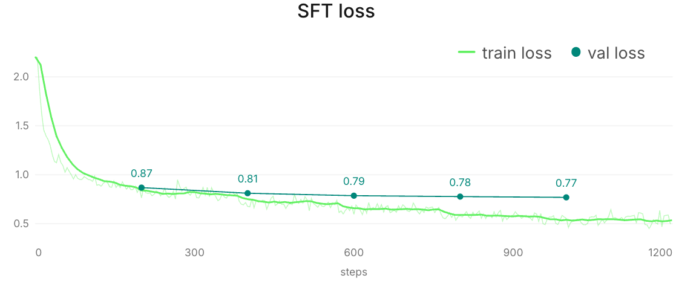

Despite the growing train–validation gap, the loss curve shows no sign of overfitting over the evaluated range.

On a 6-model validation panel, step 1,200 finishes first in 64.7% of games, including 50% of those against two Claude Opus 4.6 copies. We select it.

<strong>checkpoint selection panel</strong>

Checkpoint selection uses a fixed 6-model panel on the 10 validation deals. Qwen faces two copies of each opponent and occupies all three seats, for 180 panel games, plus 10 self-play games.

| checkpoint | panel first-place rate | vs two Claude Opus 4.6 copies | parseable | illegal reveal | self-play mean score |
|---|---:|---:|---:|---:|---:|
| base Instruct | 2.8% | 0.0% | 99.6% | 5.3% | 59.77 |
| SFT step 1,000 | 61.7% | 16.7% | 100% | 0.9% | 64.27 |
| SFT step 1,200 | <strong style="color:#00aa00">64.7%</strong> | <strong style="color:#00aa00">50.0%</strong> | 100% | 0% | 61.63 |

The self-play mean is only a sanity check, since all three copies co-evolve, but it does show that the model hasn't degenerated.

## self-play results

Across a reconstructed audit set of 7 mainline GRPO configurations, the two runs played against the SFT checkpoint remained flat. Several others improve against a fixed scripted heuristic, demonstrating opponent-specific learning. Because five configurations did not record the same stationary anchor, those gains don't measure transfer.

### transfer metrics

First-place rate among three evolving, co-adapting copies stays pinned near $\frac1{3}$ no matter how strong the policy gets, so a population-based reward can't tell us whether training went anywhere. Measuring transfer takes an anchor that doesn't move, and the step-0 SFT policy is the natural pick: it's frozen, and every run starts from it.

We track two different questions:

- The scripted-heuristic gate compares a GRPO checkpoint with frozen SFT on matched deals, which tells us whether training finds that particular opponent’s weakness.
- The frozen-SFT anchor measures the learner throughout training against the unchanged step-0 policy. Only two mainline runs record it.

Keeping the two apart matters because they diverge: several policies learn to exploit the scripted heuristic, but neither directly anchored run improves against the frozen SFT policy.

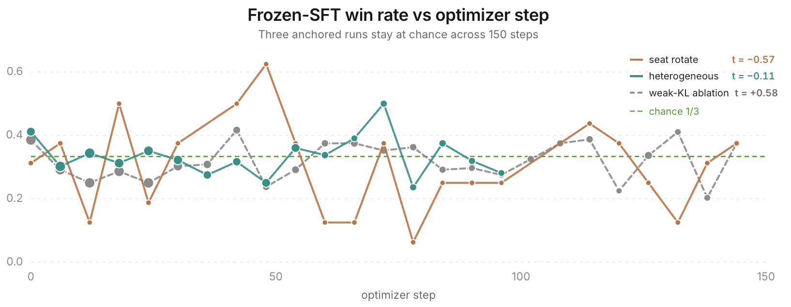

Maybe a richer league would help (nothing in these runs rules it out), but the SFT-anchor mixed-pool run and the later weak-KL ablation stay just as flat against frozen SFT.

<strong>GRPO configurations and heuristic diagnostics</strong>

All configurations share the same DAPO-style clipped objective; the labels below describe what changed in the training pool or schedule. **Snapshots** are lagged copies of the learner, and **SFT anchor** is the frozen step-0 policy. Both snapshots-plus-Flash rows replicate the same basic pool. In the frontier-API pool, the opponents are Gemini 3.1 Pro, Claude Opus 4.6, and Claude Sonnet 4.5; the 400-step run doubles the usual training horizon; seat rotation moves the learner through all three seats; and the final mixed pool combines the SFT anchor, lagged snapshots, and a decaying scripted-heuristic share (abbreviated in the figure as “heterogeneous").

| GRPO configuration | scripted-heuristic $\Delta$ own score vs SFT (95% CI) |
|---|---:|
| snapshots + Flash (replication 1) | +4.64 [2.68, 6.57] |
| snapshots only (400 steps) | +16.48 [14.26, 18.93] |
| snapshots only (replication) | +4.36 [2.89, 5.88] |
| snapshots only + seat rotation | +4.04 [−3.88, 11.88] |
| snapshots + Pro/Opus/Sonnet | −2.07 [−3.89, −0.31] |
| snapshots + Flash (replication 2) | −1.16 [−3.22, 0.89] |
| SFT anchor + snapshots + heuristic | +0.65 [−1.14, 2.43] |

The heuristic contrasts use 60 matched seed groups with eight samples each, except the 24-game seat-rotation diagnostic. Some of the gains against the script get large (up to +16 points) while nothing moves against frozen SFT: handed a fixed, exploitable opponent, the optimizer happily learns a narrow exploit.

### reward and GRPO objective

In each run, one seat is trainable while the other two come from some mixture of frozen SFT, lagged snapshots, a scripted heuristic, and external models. For each seed, seat assignment, and opponent table, the trainable policy plays the same deal $K=8$ times with different sampled responses. Each fresh rollout batch supports six optimizer steps.

The terminal reward is a squashed competitive margin: each player's score minus the average of the other two plus a bonus for finishing first. Illegal actions are penalized, and a lightly weighted shaping channel assigns intermediate credit between rounds.

<strong>reward construction</strong>

For player $i$, playing against $j$ and $k$, define competitive margin as $m_i=s_i-\frac{s_j+s_k}{2}$. The terminal reward is

$$
R_i^{\text{terminal}}
=\tanh\left(\frac{m_i}{19.6}\right)+0.1 \cdot \mathbf 1[i\text{ wins}]
$$

We calibrate the scale 19.6 so the median absolute margin maps to 0.5 via $\tanh\left(\frac{10.75}{19.6}\right) \approx 0.5$, which compresses extreme wins and losses while keeping their order. On top of that sits a shaping channel (weighted by 0.01) that assigns intermediate credit from reconstructed public-score changes between rounds, plus a terminal correction that aligns the channel's cumulative accounting with the final margin. Illegal actions receive $-0.5$.

<strong>return and advantage construction</strong>

Let $r_u$ denote the terminal, legality, or shaping reward assigned at turn $u$. For each trainable turn $q$, define the return $G_q=\sum_{u\ge q}r_u$ and subtract an exponential-moving-average baseline $b_q$ indexed by game phase and seat role. Let $\mathcal G$ contain all trainable turns from the eight sibling games. Then, we define the advantage here as

$$
A_q=\frac{(G_q-b_q)-
\operatorname{mean}_{v\in\mathcal G}(G_v-b_v)}
{\operatorname{std}_{v\in\mathcal G}(G_v-b_v)}
$$

Only turns from the trainable seat receive gradients.

<strong>optimizer health</strong>

We sample at temperature 1.0 and top-$p=0.95$, then update a rank-32 LoRA with learning rate $10^{-5}$ and KL coefficient 0.01.

The SFT-anchor mixed-pool run completes 100 optimizer steps with 192 games per rollout generation. KL, clipping, reward ordering, and parse rates all look healthy, so the flat anchor is unlikely to be a broken run.

| diagnostic | SFT-anchor mixed-pool run |
|---|---:|
| mean KL from reference | 0.0037 |
| maximum KL | 0.0061 |
| mean PPO ratio clip fraction | 0.0012 |
| advantage variance | 0.81 |
| zero-standard-deviation groups | 0 |
| advantage↔terminal-margin Spearman | 0.902 |
| training parse failures | 5 / 66,649 |
| final-eval illegal actions | 0 / 480 |

<strong>PPO and choosing not to pursue rollout-based action values</strong>

A second problem is assigning those wins to individual decisions.

### trajectory-level credit

GRPO is easy to wire up here because it avoids a separate critic, but the statistics are a poor fit. A game lasts roughly 15–25 rounds of interleaved bids, reveals, loans, and investments, with most reward arriving at the end. So an early bid and a late reveal can inherit nearly the same verdict even though either may have changed every state that follows, and same-deal comparisons remove hand luck, not this within-trajectory credit problem. Denser rewards, process supervision, or much larger groups might change this picture, but testing them was out of scope for these runs.

### state-value probe

For each fixed board $b$, let $\bar Y_b$ and $s_b^2$ be the sample mean and within-board variance of its rollout returns. Because the observed variance of board means includes finite-sample noise, we estimate the true between-board variance as

$$
\hat\sigma^2_{\text{board}}
=\max\left(0,
\operatorname{Var}_b(\bar Y_b)-\frac{\mathbb E_b[s_b^2]}{K}
\right)
$$

with within-board variance $\hat\sigma^2_{\text{trajectory}}=\mathbb E_b[s_b^2]$. In the probe, 99.8% of the estimated variance lies among trajectories from the same board, while only 0.2% lies between corrected board means. And the within-board term isn't a clean action signal either, since it mixes action effects with continuation noise. A state-value critic must learn the much smaller between-board component from labels dominated by within-board variation.

Under relative-margin self-play, all three copies benefit from the same favorable deal, which suppresses most common board advantage. The fixed-heuristic probe allows repeated outcomes to recover more of the position’s value.

State value $V(I)$ looks too noisy under these relative-margin labels. Action value $Q(I,a)$ is the more plausible target because it compares bids within the same state.

### rollout-$Q$ distillation with piKL

The first plausible fix is a [piKL](https://arxiv.org/abs/2210.05492)-style target, inspired by Meta’s work on Diplomacy, a seven-player game outside the 2p0s setting. It builds a search distribution that favors bids with higher action value $Q(I,a)$ while paying a KL penalty for moving too far from the SFT policy. Here, $Q(I,a)$ means the expected outcome after taking bid $a$ from information state $I$ and playing the game to completion.

We estimate $Q$ by simulation. The acting player cannot see the opponents’ hands or the undealt deck order, so we sample several *worlds* $w$: complete assignments of the hidden information that remain consistent with the player’s hand and the public history. In each world, we force candidate bid $a$, let the SFT continuation policy $\pi$ finish the game in the acting seat while policy $\omega$ controls the opponents, and read off the terminal score margin:

$$
Q_{\pi,\omega}(I,a)=\mathbb E_{w,\,\xi}\left[\tanh\!\left(\frac{m_{\text{terminal}}}{19.6}\right)\right]
$$

Here, $\xi$ is the continuation of the game generated by $\pi$ and $\omega$. We score every candidate on the same sampled worlds to reduce variance. The estimate $Q$ still depends on $\omega$ because changing the continuation opponent can reorder bids even when $(I,a)$ stays fixed.

piKL combines these action values with sampled action frequencies $\hat\tau$ from the SFT policy, upweighting high-$Q$ bids while remaining KLed to the SFT policy:

$$
\pi_{\text{piKL}}(a\mid I)\;\propto\;\hat\tau(a\mid I)\,\exp\!\left(\frac{Q(I,a)}{\lambda_{\mathrm{KL}}}\right)
$$

The temperature $\lambda_{\mathrm{KL}}$ controls the strength of the anchor. As $\lambda_{\mathrm{KL}}\to\infty$, the $Q$ tilt vanishes and the distribution returns to the SFT frequencies $\hat\tau$; as $\lambda_{\mathrm{KL}}\to0$, it concentrates on the sampled candidate with the largest $Q(I,a)$. The $\lambda_{\mathrm{KL}}=0$ arm in the table implements that limiting argmax directly.

We label decisions with this $Q$, build piKL targets at several $\lambda_{\mathrm{KL}}$ values, and distill them with LoRA SFT. Each candidate then occupies every seat against two frozen SFT copies over the same 120 games, 40 per seat.

| $\lambda_{\mathrm{KL}}$ | first-place rate | mean margin (95% CI) | paired Δ margin vs $\lambda=\infty$ (95% CI) |
|---:|---:|---:|---:|
| $\infty$ | 0.425 | +1.23 [−2.21, 4.68] | — |
| 1 | 0.417 | +2.73 [−1.06, 6.51] | +1.49 [−3.37, 6.35] |
| 0.3 | 0.317 | −1.38 [−4.72, 1.95] | −2.62 [−7.12, 1.89] |
| 0.1 | 0.292 | −1.79 [−5.06, 1.48] | −3.02 [−7.55, 1.51] |
| 0 | 0.350 | −0.25 [−3.64, 3.13] | −1.49 [−6.37, 3.40] |

Mean-margin arm intervals use the normal approximation; paired intervals use a $t$ interval over matched games.

At 40 bid nodes with up to six candidates each, changing only the continuation opponent from self-play to base Qwen reduces median action-rank correlation with the self-play ordering from 1.0 to 0.43, while top-action agreement falls from 100% to 27.5%. The sign of each candidate’s advantage over the reference bid still agrees 72.5% of the time. Base Qwen is admittedly a weak alternative opponent, but a drop that size is enough to show that fine $Q$ rankings depend on the continuation policy.

A second five-arm sweep replaces the self-play continuation with Gemini 3 Flash. Relative to its $\lambda=\infty$ control, the $\lambda=1$ and argmax contrasts are +6.10 [0.38, 11.82] and +5.81 [0.70, 10.93]. Take both intervals with some salt: the sweep ran once, with no correction for multiple comparisons.

On a separate 43-node offline proxy (so, no live policy comparison), aggregating $Q$ over five fixed continuation types also never beats the single-self-play-$Q$ baseline.

### action-critic pilot

GRPO’s group return cannot identify which bid changes the outcome. PPO could instead update from an action-specific advantage supplied by a learned critic. Before paying for an actor update, we test whether such a critic can rank candidate bids reliably enough to be useful.

#### critic target

The actor produces a bid using $I$ before the opponents’ bids are known. Once the auction resolves, those bids become public. During training, a critic can use this newly revealed information even though the actor never receives it at inference (centralized training with decentralized execution). We can fix the observed opponent bids $\mathbf b_{-i}^{\mathrm{obs}}$ to determine what happens when only our bid changes.

$$
Q^{\mathrm{obs}}_{\pi,\omega}(I,a)
=Q_{\pi,\omega}\!\left(
I,a\mid\mathbf b_{-i}=\mathbf b_{-i}^{\mathrm{obs}}
\right)
$$

Most raw $Q$ variation reflects whether the state itself is favorable. To isolate differences among bids, we center each target over the retained candidate set $C(I)$:

$$
\widetilde Q_C(I,a)=Q^{\mathrm{obs}}_{\pi,\omega}(I,a)
-\frac{1}{|C(I)|}\sum_{a'\in C(I)}
Q^{\mathrm{obs}}_{\pi,\omega}(I,a')
$$

Note that the centering weights candidates equally, whereas a PPO update would require an advantage weighted by the actor policy.

#### rollout labels

At each treasure-bid state reached by the actor, we sample $K=16$ bids and compress them to 6 diverse candidates. The selection retains the played bid while approximately preserving both the policy’s sampled mass and the numerical range of bids. We score every candidate on the same sampled worlds and random seeds, and hold the opponents’ observed bids fixed. After the forced bid, a deterministic frozen SFT policy completes the game, so the labels are only exact for that frozen continuation; an updated PPO actor would induce a different distribution.

#### world-sampling budget

For 32 games, we evaluate each candidate with $M=64$ hidden-world samples to get 379 bid states and ~1.5k candidate rows. Because smaller estimates reuse prefixes of the same 64 worlds, we can compare 4, 8, 16, or 32 worlds without further rollouts. "Pair-sign agreement" measures whether actions separated by a $Q$ gap of at least 0.05 and 95% paired sign confidence retain their ordering while regret measures how much reference $Q$ is lost by selecting the lower-sample-budget argmax.

| worlds | pair-sign agreement with $M=64$ | mean regret vs $M=64$ | 90th-percentile regret vs $M=64$ | all-state argmax agreement |
|---:|---:|---:|---:|---:|
| 16 | 95.45% | 0.0207 | 0.0770 | 55.3% |
| 32 | <strong style="color:#00aa00">99.77%</strong> | <strong style="color:#00aa00">0.0105</strong> | <strong style="color:#00aa00">0.0370</strong> | 71.1% |
| 64 | 100% | 0 | 0 | 100% |

Since the later training set retains confidently separated pairs, we adopt 32 worlds at half the rollout cost.

#### structured-model probe

Across all 379 calibration states, the mean spread from worst to best retained action is 0.2149 in $\tanh$-margin utility, and the estimated best action improves 0.0931 over the SFT-weighted candidate mean. That second number is an in-sample rollout-oracle bound, not realizable policy uplift. The average gap between the top two is only 0.0599, and the SFT policy’s played action is already best 36.1% of the time.

Most candidate-$Q$ variation is irrelevant to choosing a bid: 84.8% lies between states, while only 15.2% separates actions within a state. (unlike the earlier 99.8% figure, which measured whole-trajectory variance across replicas of an initial deal, this one compares candidates within a state.) PPO can use only the 15.2% component because a state-wide offset raises or lowers every candidate together.

Across 4 split seeds, 4-fold cross-validation fits small structured models to multi-action states from the $M=64$ reference labels. In the table, "uplift" is offline $Q$ improvement over the SFT candidate mixture.

Each non-control row is a gradient-boosted tree ensemble fitted to the candidate-$Q$ labels. The centralized model receives the observed opponent bids, while the actor-visible model does not. Two negative controls either shuffle the targets or drop the candidate bid, leaving a model that can predict only common state value. “Filtered pair accuracy" scores only the confidently separated action pairs defined above.

| model | filtered pair accuracy | full-set argmax | mean $Q$ uplift vs SFT |
|---|---:|---:|---:|
| centralized context | <strong style="color:#00aa00">74.8–75.9%</strong> | 33.4–35.9% | +0.0268 to +0.0315 |
| actor-visible state only | 72.3–74.6% | 32.2–35.6% | +0.0272 to +0.0314 |
| shuffled-target control | 44.3–51.9% | 23.8–29.4% | −0.0309 to −0.0062 |
| no-action control | all ties | 23.2% | −0.0680 |

#### 4B critic results

We reuse three confidence gates from calibration: gap $\ge0.05$, 95% sign confidence, and at most 6 pairs per state. The SFT-initialized critic's Bradley–Terry loss ranks the better bid above the worse one, while a Huber regression term trains the numeric centered value at weight 0.25.

| critic | filtered pair accuracy | full-set argmax (75 groups) | mean grouped regret | $R^2$ on centered advantage |
|---|---:|---:|---:|---:|
| non-leaky linear-bid baseline | — | <strong style="color:#00aa00">40.0%</strong> | — | — |
| 1 epoch, seed 0 | 62.9% | 24.0% | <strong style="color:#00aa00">0.0989</strong> | −2.31 |
| 1 epoch, seed 1 | 59.5% | 25.3% | 0.1096 | −107.54 |
| 1 epoch, seed 2 | 64.8% | <strong style="color:#00aa00">34.7%</strong> | 0.1051 | −17.64 |
| 3 epochs, seed 0 | <strong style="color:#00aa00">66.2%</strong> | 25.3% | 0.1011 | −16.56 |

Even with the preregistered gates, every neural run misses the 55% argmax threshold and the 40% linear-bid baseline.

#### compute decision

The next meaningful rung uses 128 games and roughly 1,485 decision states, at an estimated 328 H200-hours with $\pm40\%$ uncertainty; reaching 1,024 games and then evaluating on the sequestered 128-game final test approaches 3,000 H200-hours.

PPO could in principle improve beyond a fixed expert, but it must first compress expensive rollouts into small critic differences and then refresh them as the actor’s state distribution moves.

Given those costs and the calibration results above, we stop after the critic diagnostics, without building a production label corpus or running an actor update.

## bid-distribution model

A corpus of policy-generated games contains two kinds of information:

1. a few terminal outcomes (one final margin per player), each noisily supervising a long sequence of actions against particular opponents;
2. thousands of local market observations of the form “given this public state, this policy bids $b$."

GRPO uses the first at trajectory level, while the action critic tries to refine it to individual decisions. The second kind is what we model here, as a conditional price law $\hat F$ that makes a single sealed-bid auction inside the multiplayer game tractable: given an estimated lot value and a distribution over opponent bids, we can score every legal bid by expected surplus.

A point model treats one predicted opponent bid as certain. A distribution instead asks what fraction of the predicted bid mass each candidate beats:

$$
U_{\hat F}(b)=(\hat V-b)\hat P_{\hat F}(\text{win}\mid b)
$$

<strong>why point predictions are insufficient</strong>

One final search variant keeps the terminal rollouts but replaces the opponents’ current bids with deterministic predictions from a fitted market model. The best arm changes paired margin by only +0.58 [−5.6, +6.8], which leaves the question unresolved.

A separate diagnostic asks whether a much better point predictor would solve the problem. A gradient-boosted tree trained on ~3.2k logged Gemini 3 Flash bids reaches an out-of-fold mean absolute error (MAE) of 1.10 coins with essentially zero bias (all variance). However, it still predicts the wrong side of the actual win/loss threshold on 26.1% of auctions. 55% of auctions resolve within one coin, where Flash’s own sampling noise straddles the boundary even when the conditional mean is accurate.

With a distribution in hand, prediction error shifts probability mass across outcomes rather than flipping a discrete win/loss call. We develop the first version on Gemini 3 Flash logs, then test whether the SFT policy’s own bids can fit the same price law.

### value model

The acting player knows three useful quantities for color $c$:

* $\text{display}_c$: how many gems of that color are already public
* $\text{own hand}_c$: how many of that color remain in their own private hand
* $\text{collection}_c$: how many have been removed into public collections

There are six gems of each color in the game. Because the player’s remaining hand eventually enters the display, a live lower bound on the final count is $L_c=\text{display}_c+\text{own-hand}_c$. Collected gems never enter the display, so an upper bound is $U_c=6-\text{collection}_c$. An 11-feature classifier uses these bounds, reveal progress, and round number to predict the final count $n_c$, one of 7 values from 0 through 6; it never sees opponents’ hidden hands. The prediction also remains independent of the Value Chart until inference, when we convert the count distribution to points.

We split games 70/10/20 for fitting, calibration, and held-out testing and train using a regularized MLP for at most 300 iterations.

For a lot with colors $g_1,\ldots,g_r$, the head outputs the 7-way count distribution $\hat P(n_{g_i}=k\mid I)$. We map that distribution through the active chart to get each gem’s raw expected value, then apply an isotonic calibration map $f$ before summing the gems, a flexible one-dimensional correction curve that can fix systematic bias while preserving monotonicity:

$$
\hat V_{\text{lot}}
= \sum_{i=1}^r f\!\left(\sum_{k=0}^{6}
\hat P(n_{g_i}=k\mid I)\operatorname{Chart}(k)\right)
+ \operatorname{MissionBonus}(\text{collection},\text{lot})
$$

Here $\operatorname{Chart}(k)$ is the eventual **per-gem** value when $k$ gems of that color appear in the final display; the mission term is computed exactly. Thus $\hat P$ is the classifier output, while $\hat V_{\text{lot}}$ is the calibrated value supplied to the selector.

### bid model

A histogram gradient-boosted regressor predicts each opponent seat’s conditional mean bid $\hat\mu_s(x)$ from 16 public features (e.g. coin count, lot size and displayed value, recent clearing prices, and tiebreak position). We fit it on ~3.6k Gemini 3 Flash bid rows, cross-validated in folds grouped by paired seed. The grouped out-of-fold MAE is 1.230 coins with bias +0.013; 69.4% of predictions land within one coin.

A conditional mean alone still throws away everything the residuals can tell us about the model’s own errors. Let $B_s$ be opponent seat $s$’s actual bid in the current auction. We retain every out-of-fold residual $\epsilon=B_s-\operatorname{round}(\hat\mu_s(x))$ and pool them into an empirical noise distribution. At inference, we shift those historical errors by the current predicted mean, round to integers, and clamp to the opponent’s legal budget. With $N$ stored residuals and current budget $c_s$,

$$
\hat P(B_s=z\mid x)=\frac{1}{N}\sum_{r=1}^N\mathbf 1\left[z=\operatorname{clip}\big(\operatorname{round}(\hat\mu_s(x)+\epsilon_r),0,c_s\big)\right]
$$

For clarity, suppose the current mean prediction is 8 and the residual law puts 20% of its mass at −1, 50% at 0, and 30% at +1. The implied opponent bids are 7, 8, and 9 with probabilities 0.2, 0.5, and 0.3. Bidding 9 is no longer treated as a certain win: it beats 70% of that distribution and wins or loses the 30% tie mass according to public tiebreak order.

With exact tiebreak handling, the probability that candidate bid $b$ beats opponent $s$’s unknown bid $B_s$ is

$$
p_s(b)=\hat P(B_s<b)+\mathbf 1[\text{wins tiebreak}]\hat P(B_s=b)
$$

Assuming the opponents’ remaining bid variation is conditionally independent, the probability of beating both factors as

$$
\hat P(\text{win}\mid b,x)=\prod_{s\ne i}p_s(b)
$$

Independence is only approximately true here, but the public features already capture many shared causes of bidding, leaving the residual variation specific to each opponent. Modeling the full joint conditional distribution $P(B_1,B_2\mid x)$ would require substantially more data because the possible bid pairs form a much sparser outcome space.

<strong>chosen-action calibration check</strong>

We check ordinary chosen-action calibration on the games used for the myopic selector evaluation. Across ~1.8k seat-0 treasure bids against 2x Gemini 3 Flash opponents, mean predicted win probability is 40.3% and empirical win frequency is 36.2%. The model is close at the extremes but less calibrated in several middle-probability bins.

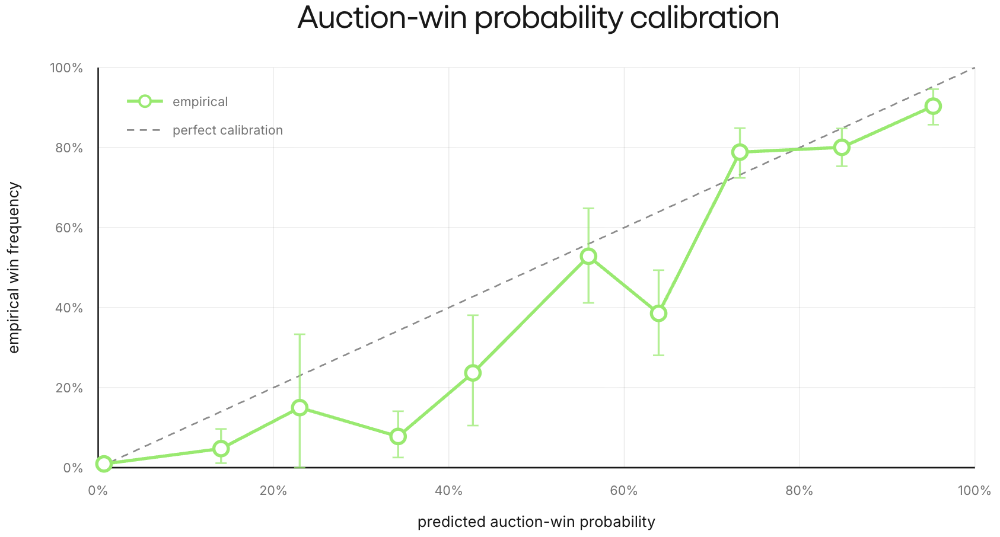

### offline regret

We collect 164 logged games in 82 seed clusters where the SFT policy plays against 2x Gemini 3 Flash opponents. The games yield ~1.8k seat-0 treasure decisions and ~3.6k opponent-bid rows (2 per decision).

Because the final display reveals each lot's realized value, we can replay any counterfactual bid against the actual logged opponent bids and score it against the cheapest price that would have won. That decision regret captures two failures:

* **Overpaying:** when a bid wins, regret is the surplus forfeited by paying above the cheapest winning price.
* **Passing:** when a bid loses a profitable lot, regret is the whole surplus left on the table.

<strong>defining decision regret</strong>

For each seat-0 decision, the final display reveals the treasure lot’s realized value $V$. Let $p$ be the highest recorded opponent bid. The ideal clearing-price surplus is $S^*=\max(0,V-p)$. For a counterfactual bid $b$, we resolve the auction against the opponent bids, giving realized surplus $S(b)=(V-b) \cdot \mathbf 1[b\text{ wins}]$. Then just define decision regret as

$$
R(b)=S^*-S(b)
$$

Zero regret can be unattainable when the budget cannot beat a profitable clearing price, or when $V>p$ but losing the tiebreak makes the cheapest winning bid $p+1$ instead of $p$.

To isolate the price model, every counterfactual bidder receives realized terminal gem value $V$ and no mission bonus. Later, our selector replaces that privileged value with $\hat V$ plus exact mission value.

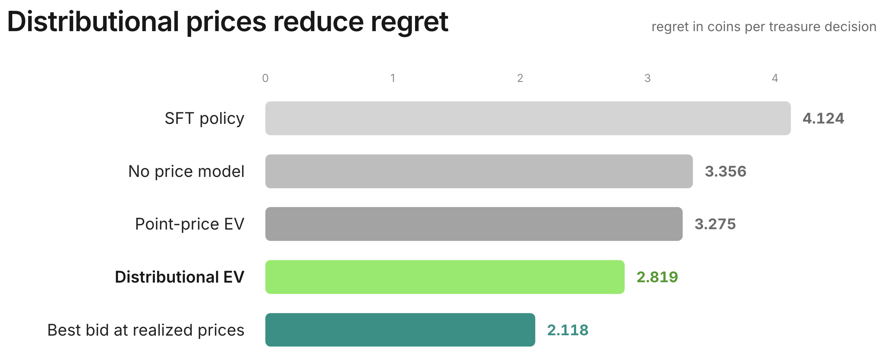

We compute regret differences within each seed cluster. The oracle beats the logged SFT bids by 1.304 coins per decision, while retaining residual uncertainty reduces regret by another 0.456 coins per decision relative to the point version using the *same fitted mean*.

## live failure of the myopic selector

Our selector first samples an ordinary SFT response, then calculates the EV curve for every legal bid and takes the argmax to get $b^*$. To prevent weak analytic preferences from overwriting coherent LLM behavior, it deviates only when the estimated improvement in immediate expected value is at least one coin:

$$
U(b^*)-U(b_{\mathrm{SFT}})=(\hat{V}-b^*)\hat{P}(\text{win} \mid b^*, x) - (\hat{V}-b_{\mathrm{SFT}})\hat{P}(\text{win} \mid b_{\mathrm{SFT}}, x)\ge1
$$

We compare three strategies: selector off, selector on, and selector on with history repair so future turns see a consistent record of changed actions. All three play the same 150 seeds against two Gemini 3 Flash opponents, with Qwen fixed in seat 0, and each treatment is scored against selector-off on the same seed.

Live, the selector fails: raw paired margin changes by −5.01 points per game with 95% CI [−10.04, +0.02]. All that offline regret reduction simply does not translate into better full-game performance.

<strong>control-variate adjustment</strong>

We introduce a control variate to reduce auction-resolution noise: a decision should not receive full credit because an opponent happens to sample below its usual price, or full blame because the opponent samples above it.

For each treasure decision $d$, let $y_d=1$ if the bid wins and $y_d=0$ otherwise, let $p_d$ be the model’s predicted win probability, and let $V_d-b_d$ be the lot’s estimated surplus. Define the decision-level resolution surprise as $x_d=(y_d-p_d)(V_d-b_d)$, which converts auction luck into score units: a surprising outcome matters more when the lot’s surplus is larger. For arm $a$, game $g$, and seat $k$, sum the surprises over that seat’s decisions:

$$
X_{a,g,k}=\sum_{d\in\mathcal D_{a,g,k}}x_d
$$

For the adjustment to be unbiased, the model must satisfy the stronger, value-weighted calibration condition

$$
\mathbb E[x_d\mid I_d]
=\mathbb E[(y_d-p_d)(V_d-b_d)\mid I_d]
=0,
$$

where $I_d$ is the information available at the decision. Ordinary calibration of $p_d$ alone isn't sufficient because the surplus $V_d-b_d$ varies across decisions. For each matched seed, define the seatwise luck contrast $Z_{g,k}=X_{\mathrm{on},g,k}-X_{\mathrm{off},g,k}$ and the paired margin difference $D_g=\text{margin}_{\mathrm{on},g}-\text{margin}_{\mathrm{off},g}$. We regress

$$
D_g=\tau+\sum_{k=0}^{2}\beta_k Z_{g,k}+\epsilon_g.
$$

The intercept $\tau$ is the adjusted treatment effect. In a paired pilot, this regression explains 42% of the paired variance, a 1.72× reduction. No direct validation of the stronger value-weighted calibration condition is available, so later gates report the raw paired effect as the primary evidence and the adjusted estimate as model-assisted corroboration.

Adjustment removes about 3 points of adverse resolution luck, yielding −1.88 [−6.57, +2.81], and the adjusted history-repair arm is outright harmful at −5.16 [−9.90, −0.41]. Even with luck accounted for, the myopic selector still loses.

The component breakdown shows where the points went:

| paired component | treatment minus control |
|---|---:|
| treasure spend | +6.81 |
| final gem value | +5.17 |
| mission rewards | +3.17 |
| loan repayments | +3.73 |
| investment returns | −7.13 |
| own final score | −3.61 |

Improving one-auction expected value harmed the full game because myopic spending depleted liquidity. Extra loan repayment and foregone investment returns together cost 10.9 points per game, overwhelming the gains from gems. The intervention also raised early clearing prices by 1.48 coins and lowered late prices by 1.04 after liquidity was depleted.

An obvious suspect is the calibration error in $\hat V$, which overstates realized lot value on this distribution, suggesting the gate might select lots worth less than their price. But lots won on deviation and non-deviation decisions carry similar value bias, so the one-coin gate isn't uniquely selecting overvalued lots and cannot explain the loss.

Basically, we had dismissed the fact that myopic EV ignores the option value of a coin.

## pricing liquidity

At face value, a coin contributes one point to final score. During the game, though, its real value is the best thing you can still do with it: buy the current lot, wait for another auction where the coin goes further, sink it into an investment, or deny an opponent a loan. Since you hold the right but not the obligation to spend it, liquidity behaves like an option.

Early in a game, holding a coin preserves many possible uses across the remaining deck. Late in a game the effect can flip: if valuable lots remain and the other players are nearly broke, the same coin carries unusual market power because few rivals can contest it. Either way, the relevant quantity is the continuation score lost when that coin is spent in the current state, and that can exceed its face value.

Let $J(I_t,c)$ be expected continuation score from information state $I_t$ with $c$ coins, holding the rest of the state fixed. The marginal continuation value of the last coin is

$$
\lambda(I_t,c)=J(I_t,c)-J(I_t,c-1)
$$

Rather than solve that dynamic program, we hold the premium constant: $\lambda_{\text{coin}}$ approximates the value of a coin above the one point already charged when cash leaves the final score. The corrected objective subtracts a fixed calibration offset $\delta$ from predicted lot value and charges that constant shadow premium for the future flexibility lost with every paid coin:

$$
U_{\delta, \lambda_{\text{coin}}}(b)
=\left[(\hat V-\delta)-(1+\lambda_{\text{coin}})b\right]
\hat P(\text{win}\mid b)
$$

The earlier component table already says the premium must be positive: the invest and loan auctions move by roughly $\frac{3.73+7.13}{6.81}\approx1.60$ points for each extra coin of treasure spending.

We therefore sweep the liquidity premium $\lambda_{\text{coin}}$ and the calibration offset $\delta$ at gate 1, plus three gate-only arms. On margin alone the best arm is $\lambda=1,\delta=0$ at +26.42 points. But every $\lambda\ge1$ arm enters a proxy-rescue regime where the selector overbids, and it gains by vetoing proposals that the live LLM does not make.

We pick $\lambda=0.5,\delta=2$ instead. During evaluation, it yielded +22.62 with 4.33 deviations per game.

### live evaluation

We measure the combined fix on 150 paired seeds against Gemini 3 Flash opponents.

| metric | control | paced selector | Δ (treatment − control) |
|---|---:|---:|---:|
| first-place rate | 36.0% | 59.3% | +23.3 percentage points |
| mean margin | −7.17 | +4.99 | +12.16 [7.61, 16.71] |

The model-assisted adjustment is +12.62 [8.28, 16.96]. Pacing also preserves the extra asset value while removing the financing damage:

| paired component | paced selector minus control |
|---|---:|
| treasure spend | −0.53 |
| final gem value | +5.44 |
| mission rewards | +2.77 |
| loan repayments | +1.00 |
| investment returns | −0.25 |
| own final score | +8.41 |

Treasure count changes by only +0.02 from control. The financing penalties collapse, and the early/late clearing-price cascade disappears.

To be clear about scope: the win comes from a gated treasure-bid intervention, not a complete game policy. The SFT model still handles treasure bids rejected by the gate, reveals, loans, and investments.

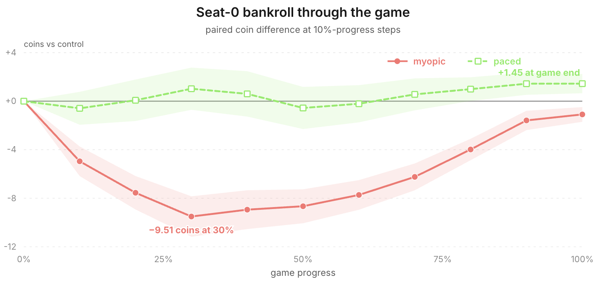

## refitting on SFT bids

The price law above is fitted on Gemini 3 Flash bids, so it encodes Flash's bidding habits. We refit the same model family on ~1,800 SFT-policy bids, keeping $\lambda_{\text{coin}}=0.5$, $\delta=2$, and gate 1.0. Flash bids no longer enter the fit, although the three decision-rule constants still come from Flash-centered diagnostics.

On the Flash replay corpus, the SFT-fitted law retains 91% of the oracle-value offline regret improvement over the logged SFT bids: regret falls from 4.12 to 2.94, compared with 2.82 for the Flash-fitted law. Similar regret on these logged auctions does not show that the two policies bid alike.

Across 150 new paired seeds, the control’s first-place rate is 32.7% and the SFT-fitted selector reaches 50.7%. Raw paired margin improves by +8.47 [3.99, 12.94], while control-variate-adjusted margin improves by +10.19 [6.14, 14.24] with $t=4.93$.

The SFT-fitted law retains 81% of the Flash-fitted selector's +12.62-point gain, and the early/late market cascade does not reappear.

## distillation

<strong>expert iteration (ExIt)</strong>

ExIt alternates between a policy that visits states and an expert that improves the action taken in those states. If the current policy $\pi$ induces a state distribution $I\sim d_\pi$, the expert supplies

$$
a^*(I)=\arg\max_{a\in\mathcal A(I)}U(a\mid I)
$$

and the resulting dataset $\mathcal D_E$ trains a new policy by imitation:

$$
\theta'=\arg\min_\theta
-\mathbb E_{(I,a^*)\sim\mathcal D_E}
\left[\log\pi_\theta(a^*\mid I)\right]
$$

The new policy can generate another state distribution, which the expert can label again, giving the loop $\pi_k\rightarrow d_{\pi_k}\rightarrow\mathcal D_E\rightarrow\pi_{k+1}$. Unlike ordinary SFT from a fixed teacher corpus, the supervision is concentrated on states the current policy actually reaches and on actions the expert would change.

Here, we run one such iteration. The current SFT policy generates the games, and the paced analytic selector is the expert: its utility $U$ combines predicted lot value, the opponent bid distribution, and the shadow price of liquidity. We then distill its selected bids into the model weights.

### corpus

We play 400 fresh mixed-policy games in which the analytic selector controls seat 0 (using the SFT-fitted price law and gate) while the other two seats remain plain SFT policies. Opponent policies stay fixed this way, although the selector’s bids can still change later budgets and market history.

~4.7k bid decisions are produced, including ~1,200 selector deviations, plus another opponent-type check along the way: the selector-augmented SFT policy finishes first against two SFT clones in 48.7% [43.9, 53.6] of games, above the $\frac1{3}$ baseline.

Three row types make up the SFT export: expert deviations, pass-throughs where the selector agrees, and loan and investment anchors.

<strong>three row types</strong>

1. **deviations:** replace the SFT bid with the analytic expert’s target and expose the quantities that determine it: $\hat V$, opponent price means, $P(\text{win})$ for both the SFT bid and the selected bid, budget, and paced surplus
2. **pass-throughs:** retain the raw SFT response when the selector agrees or finds less than one coin of EV lift, so the adapter does not relearn every sound decision
3. **loan and investment anchors:** retain the SFT policy’s original financing responses, so an improvement to treasure bidding does not erase the liquidity discipline that makes it work

Pass-through and financing anchors come from all three seats. Only seat 0 contains selector deviations, so all-seat anchors reduce the risk that the adapter learns a `player_id = 0` shortcut.

<strong>deviation example</strong>

In one game, round 9, seat 0 has 22 coins and a public collection of three Green and one Yellow gems. The current auction offers two more Green gems, enough to complete a mission, and the ordinary SFT policy samples a bid of 22.

After the calibration correction, the frozen expert values the lot at 30.59 coins, including the 10-point mission bonus it would complete, and predicts opponent mean bids of 10 and 11. A bid of 22 wins with certainty, but once each coin’s option value is priced in, its paced utility turns negative, and a lower bid preserves most of the win probability at a far better price:

$$
\begin{align*}
U(22)&= [30.59-1.5(22)]\cdot 1.0000=-2.41 \\
U(13)&= [30.59-1.5(13)]\cdot 0.8825=+9.79
\end{align*}
$$

The final 12 percentage points of win probability cost too much, so the expert shades the bid to 13. The training target reads:

> This treasure is worth about 31 to me net of bias. 22 would overpay once each coin's option value is priced in (budget 22); shading to 13 keeps the win probability at ~88% and earns more surplus per coin. Expected surplus favors 13.
>
> `{"bid": 13}`

That prose comes from a template filled with four logged quantities: $\hat V$, both bids, win probability, and remaining budget. At this stage, every deviation target shares the same synthetic voice.

Since the log preserves neither the SFT policy’s free-form rationale nor a student response, what is shown above is the supervision target itself.

### offline gates

We hold out 15% of games by seed. Our primary metric, EV closure, is the share of the expert’s utility improvement over the recorded SFT bid that the student recovers on held-out deviation states, ranging from 0 (no gain) and 1 (matches the expert).

<strong>EV closure</strong>

$$
\operatorname{closure}
=\frac{U(b_{\text{student}})-U(b_{\mathrm{SFT}})}
{U(b_{\text{expert}})-U(b_{\mathrm{SFT}})}
$$

Closure measures how much of the expert’s utility improvement the student recovers on held-out deviation states, where the denominator is positive by construction. A value of 0 means no utility gain over the recorded SFT bid, 1 means equal utility to the expert, not necessarily the same bid, values above 1 are possible. The “SFT reference" below is a fresh stochastic response to the same prompts, so it need not reproduce the recorded $b_{\mathrm{SFT}}$ and can score above zero.

The deviation:pass-through:anchor mixture is $2:2:1$, and we repeat each deviation three times to emphasize the new supervision over rows that merely clone existing SFT behavior. An earlier development build, used to choose that recipe, reaches 0.674 closure and 0.883 direction agreement. Direction agreement is the fraction of student bids that move from the recorded SFT bid in the expert’s direction. We then freeze the recipe and rebuild the corpus from the final selector run. On this final corpus, the student recovers roughly three-quarters of the expert’s improvement (EV closure 0.760, versus 0.316 for a fresh SFT response) and moves in the expert’s direction on 87.8% of bids (versus 52.3%); parse validity is 1.00, and financing MAE is 1.751 versus 1.937.

### weights-only evaluation

Removing the selector entirely, the distilled weights improve raw paired margin by +7.97 [2.70, 13.25] over SFT. Against Gemini 3 Flash, the control wins 29.3% with mean margin −12.83, whereas the distilled weights win 40.7% with mean margin −4.85.

Two implementation choices make the weights-only effect smaller than the Flash-fitted selector's:

1. Replacing the Flash-fitted price law with an SFT-fitted law removes privileged opponent statistics and reduces the selector’s effect before distillation.
2. Supervised distillation reduces the adjusted effect from +10.19 to +7.42 points, retaining about 73%.

### style matching

Paraphrasing the synthetic targets restores the SFT model’s response style without a detectable loss in game strength. The compact templates reduce median response length to 254 characters, versus roughly 1,016 for the SFT policy; a style-matched corpus has the SFT model paraphrase each deviation target in its own voice, restoring the original length.

The LoRA trained on paraphrased responses retains held-out closure of 0.718 and direction agreement of 0.849. In evaluation, raw paired margin improves by +8.31 [3.21, 13.42], and the adjusted estimate is +7.95 [3.16, 12.74]. Against the template LoRA, the adjusted difference is +0.02 [−5.06, +5.10], but it still retains 78% of the SFT-fitted selector’s adjusted live effect, so the style-matched LoRA is the one we take to final evaluation.

### remaining imitation gap

We fit a new price law on roughly 7,000 bids from 200 games of distilled-model self-play. Its mean prediction differs from the SFT law by 0.753 coins, but the two laws’ best-response regrets differ by only 0.068 coins per decision.

To measure the remaining imitation gap, we add a selector fitted to that new price law on top of the distilled model. Relative to the SFT control, raw paired margin improves by +11.99 [6.41, 17.56], and the adjusted estimate is +10.94 [6.00, 15.88]. Relative to weights alone, the selector adds +3.95 [−0.83, 8.74]. It now changes only 15.9% of treasure decisions, versus 27.8% on the original SFT policy.

The optional selector produces +9.44 [4.55, 14.33] margin, with descriptive per-seat effects of +7.26, +10.94, and +10.12 across the 3 seats. Against two Claude Sonnet 4.5 opponents, it achieved +25.12 [13.78, 36.46] and against Gemini 3.1 Pro, +6.10 [−4.67, 16.87], directionally positive but underpowered.

A later Flash test shows that the selector's effect varies by seat. Across 300 paired games on 100 seeds, its overall effect is +4.32 [0.98, 7.66], but seat 0 is flat while seats 1 and 2 are positive; the earlier test was positive in every seat.

The table follows the intervention from the myopic selector through distillation. Every value is a treatment-minus-control change from a separate experiment, so compare within columns rather than across them. The weights-only column uses the compact-template LoRA; the figure uses the style-matched LoRA selected for final evaluation.

| paired component | myopic selector | paced selector | SFT-fitted | distilled LoRA | distilled LoRA + selector |
|---|---:|---:|---:|---:|---:|
| treasure spend | +6.81 | −0.53 | −0.44 | −0.63 | +0.51 |
| final gem value | +5.17 | +5.44 | +4.08 | +1.89 | +6.37 |
| mission rewards | +3.17 | +2.77 | +2.40 | +2.23 | +3.07 |
| loan repayments | +3.73 | +1.00 | +1.87 | +0.93 | +2.20 |
| investment returns | −7.13 | −0.25 | −1.01 | −0.57 | −1.64 |
| own final score | −3.61 | +8.41 | +5.62 | +4.33 | +7.33 |

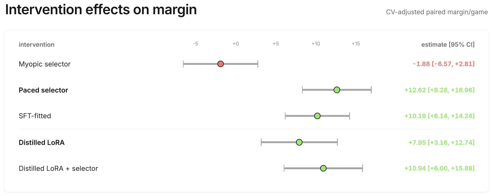

The incremental live interval includes 0, and offline gates find the residual labels only weakly learnable, so another round of ExIt isn't justified.

<strong>ExIt Round 2?</strong>

Across separate experiments, adjusted point estimates leave a 2.99-point gap; the direct within-run selector increment is +3.95 [−0.83, 8.74]. Applying the two measured distillations’ 73–78% retention range to that gap suggests only ~2.2 points from another round, but this estimate is just an extrapolation.

## final benchmark

The final benchmark evaluates the style-matched distilled 4B weights alone, with no analytic selector active at inference.

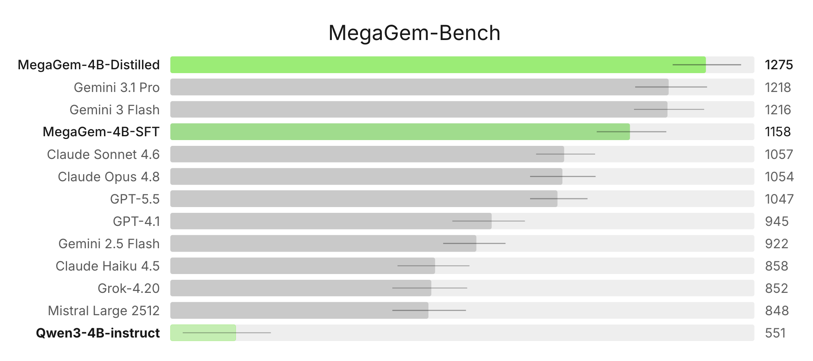

In the 13-model Steiner-triple benchmark, direct comparisons resolve wins over 10 of 12 opponents. Against SFT, Distilled finishes higher in 75% of shared games [58%, 88%], an internal check outside the development evaluations.

To sharpen the ordering of the top three, we evaluate Distilled, Gemini 3.1 Pro, and Gemini 3 Flash together on 150 seeds with all three seat rotations. The resulting 450 games comprise 150 independent deal clusters; the intervals resample the three rotations together.

| pair | fraction A finishes above B | 95% CI | mean score difference |
|---|---:|:---:|---:|
| Distilled vs Gemini 3 Flash | <strong style="color:#00aa00">0.56</strong> | <strong style="color:#00aa00">[0.52, 0.60]</strong> | +5.2 |
| Distilled vs Gemini 3.1 Pro | 0.53 | [0.48, 0.57] | +0.8 |
| Gemini 3.1 Pro vs Gemini 3 Flash | <strong style="color:#00aa00">0.59</strong> | <strong style="color:#00aa00">[0.54, 0.65]</strong> | +4.4 |

The specialist beats Gemini 3 Flash and is statistically unresolved against Gemini 3.1 Pro.

## specialist traces

Here are three raw final-evaluation traces from the [distilled model](https://huggingface.co/djdumpling/qwen3-4b-instruct-megagem-distill-para), covering mission value, tiebreak order, and liquidity.

<strong>Trace 1: pricing a mission and the tiebreak together</strong>

Here, the model plays seat 0 against GPT-5.5 and Gemini 3.1 Pro. By round 8, it has 14 coins and a collection of Yellow and Purple. A Blue gem would complete the 5-point Blue–Yellow mission, and revealing the Blue in its private hand would move Blue from 4 to 8 points per gem. One opponent has only 6 coins, while the model has tiebreak priority over the other.

The model writes:

> Winning this Blue gem would immediately complete the "specific_2_by" mission (Blue + Yellow) for 5 coins and put me one step closer to the "specific_3_bgp" mission (Blue + Green + Purple) for 10 coins.
>
> A bid of 6 ensures I beat Player 1's maximum possible bid. If Player 2 bids 6, I win on tiebreak. If Player 2 bids higher, they are spending a significant portion of their capital early. Given the mission rewards and the value of the gem, 6 is a strong but efficient bid that preserves my coins for future rounds.
>
> `{"bid": 6}`

The bids come in 6, 6, and 5: the model wins the tie, claims the mission, and reveals Blue. Ignoring any later increase in Blue's price, the immediately visible surplus is already at least

$$
8\ \text{(gem value)}+5\ \text{(mission)}-6\ \text{(price)}=7
$$

The bid of 6 captures at least 7 points of immediate surplus while preserving 8 coins. The model eventually wins 93–89–59.

<strong>Trace 2: recomputing the minimum bid after winning</strong>

The same game produces a cleaner test of state tracking in rounds 13 and 14. Both opponents have exhausted their cash. In round 13, the model is first in tiebreak order, so it recognizes that a zero bid wins the Blue gem:

> Player 1 has 0 coins, Player 2 has 0 coins. Neither can bid above 0!
>
> I'm first in tiebreak order, so if we all bid 0, I win.
>
> This is a free win at 0 coins! Since both opponents have 0 coins, they can only bid 0. I have tiebreak priority, so bidding 0 guarantees I win the Blue gem for free.
>
> `{"bid": 0}`

All three players bid 0, and the model wins. Winning moves it to the back of the tiebreak order. On the next auction, a two-gem Yellow–Blue lot, it updates rather than repeating the previous action:

> Player 2 > Player 1 > Me. So if everyone bids 0, Player 2 wins. I need to bid at least 1 to guarantee winning.
>
> Bidding 1 is clearly optimal—it guarantees the win while costing almost nothing.
>
> `{"bid": 1}`

The other players again bid 0, so the model buys both gems for 1, and these two purchases contribute to the same 93-point win above.

<strong>Trace 3: borrowing to finish a mission line</strong>

In another game, the model plays seat 1 against Gemini 3.1 Pro and GPT-5.5. In round 13 it has 14 coins, while GPT-5.5 has 7 and acts earlier in ties. Purple would complete the 5-point Red–Purple mission, so the model chooses the exact guaranteed price:

> Player 2 has 7 coins and is ahead of me in the tiebreak order. To guarantee a win against Player 2, I must bid 8.
>
> Spending 8 now for a gem that is worth at least 12–16 coins (plus the 5-coin mission) is a net positive, and I still retain 6 coins for future rounds.
>
> `{"bid": 8}`

The bids are 0, 8, and 7, so the model wins Purple and the mission. It now has only 6 coins. The next card is a 10-coin loan, and its rationale connects that financing decision to the remaining mission:

> Winning this loan would provide immediate liquidity (10 - bid) to compete for the remaining 4 auctionable gems, which is crucial because I need a Yellow gem to complete the "specific_3_rgy" mission (10 coins) and a second Purple for the "same_2_purple" mission (5 coins). However, bidding too high on a loan is counterproductive as it increases my end-game debt without adding net value.
>
> `{"bid": 5}`

The loan bids land at 2, 5, and 4, and winning raises the model's available cash to $6+(10-5)=11$. On the next auction, another Purple, GPT-5.5 still has 7 coins and the better tiebreak position, so the covering price is again $7+1=8$:

> Player 2 has 7 coins max. They might bid up to 7. I should bid 8 to guarantee winning over Player 2's maximum.
>
> Given the expected surplus-maximizing bid is 8, and this is worth ~17+ to me, bidding 8 is clearly optimal.
>
> `{"bid": 8}`

Again the bids are 0, 8, and 7, and the model wins its second Purple and the 5-point mission. It finishes first, 72–66–49, with

$$
2\ \text{coins}+56\ \text{gem value}+10\ \text{missions}
-30\ \text{loan repayments}+34\ \text{investment returns}=72
$$

The first Purple purchase leaves the model short of cash. The loan repairs that shortage and funds a second exact covering bid for the mission.

## conclusions

Had we only measured progress against the scripted heuristic, this post would have told a self-play success story. Beating a script is not the same as improving against frozen SFT, and in the runs with a stationary anchor, relative-outcome rewards did not produce measurable transfer across the opponent populations we tested.

What carried the project instead were the bid logs, which proved more useful than the outcome rewards: they let us estimate the asset value $\hat V$ and market distribution $\hat F$, then replay alternative bids against recorded auctions. Our first selector optimized the current auction, spent too quickly, and lost 5.01 points of raw paired margin. Charging for the future use of cash turned that same machinery into a +12.16-point gain.

The same selector also gave us decision-level training targets, each label connecting a bid to its price, win probability, and remaining budget. Distilling those choices into the 4B model produced the final 1275-rated checkpoint, with no analytic selector running at inference.
